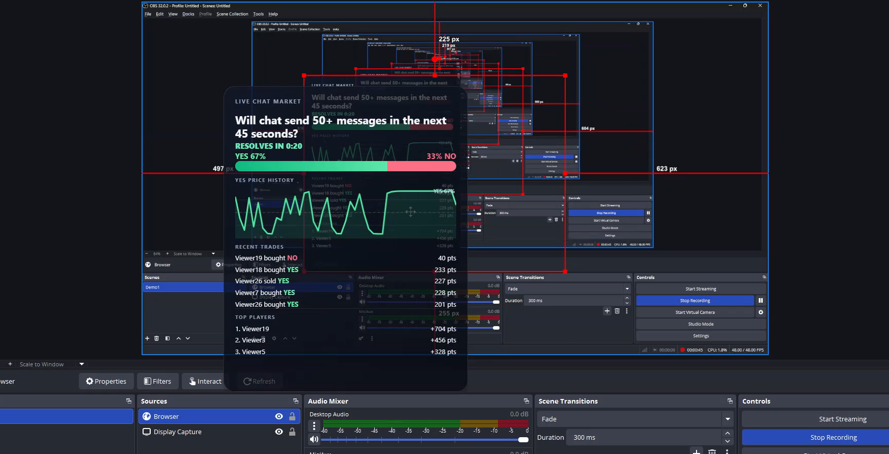
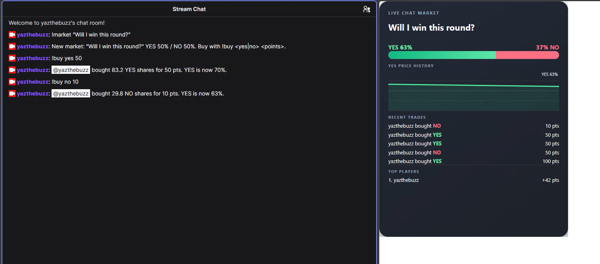

# Twitch Chat Markets

A prediction market for Twitch chat: viewers buy and sell YES/NO shares on live outcomes using virtual points, and the odds move with every trade. A broadcaster or moderator can open a market, or chat activity can open and resolve auto markets. A live OBS overlay shows the market, prices, recent trades, and top players.

## How it differs from Twitch Predictions

Twitch Predictions runs one fixed-pool question at a time. Here, viewers can buy and sell throughout an open market, and prices update continuously using LMSR pricing.

## Highlights

- Twitch EventSub WebSocket integration for `channel.chat.message` and Helix `Send Chat Message`, with automatic access-token validation and refresh.
- Auto markets based on chat message volume, the most common chat word (emote spam), and unique chatters; outcomes resolve from observed chat counts.
- OBS browser-source overlay at `/overlay/<channel_id>`, updated live over Server-Sent Events.
- Every viewer receives the same starting stake for each market. Points, markets, positions, and leaderboards are isolated per channel.
- Virtual points only; there are no purchases, cash-outs, or real-money trading.
- Offline simulator for trying the market and overlay without Twitch credentials or an audience.
- Built with OpenAI Codex.

## Demo

Demo video: https://youtu.be/KJtnoRKYKMc




## Quick start: simulator, no Twitch credentials

Requires Python 3.11 or newer. From the project root, install dependencies and start the looping simulator with its overlay:

```powershell
python -m venv .venv
.venv\Scripts\Activate.ps1
python -m pip install -r requirements.txt
python -m twitch_bot.simulate --serve --demo
```

The simulator prints overlay URLs for its fake channels. Open the first one in a browser or OBS Browser Source:

```text
http://127.0.0.1:8080/overlay/fake-channel-a
```

`--demo` loops through auto-market templates with simulated chat and trades; stop it with `Ctrl+C`. To choose a different overlay port, set `OVERLAY_PORT` before running (default `8080`).

## Run it on Twitch

1. In the [Twitch Developer Console](https://dev.twitch.tv/console/apps), register an application. Set OAuth Redirect URL to `http://localhost:3000` and choose **Confidential** as the client type. Save the client ID and client secret.
2. Install and configure the [Twitch CLI](https://dev.twitch.tv/docs/cli/). Use the app's client ID and secret, then generate a user token with the required chat scopes:

   ```sh
   twitch configure
   twitch token --user-token --scopes "user:read:chat user:write:chat"
   ```

   Copy the resulting user access token and refresh token. The Twitch account whose token you use is the bot account (`TWITCH_USER_ID`); it also needs to be authorized to read and write chat in each broadcaster's channel.

3. Create `.env` in the project root with your own values (these placeholders are not credentials):

   ```dotenv
   TWITCH_CLIENT_ID=<your_client_id>
   TWITCH_CLIENT_SECRET=<your_client_secret>
   TWITCH_ACCESS_TOKEN=<your_user_access_token>
   TWITCH_REFRESH_TOKEN=<your_refresh_token>
   TWITCH_USER_ID=<bot_account_user_id>
   # Optional: comma-separated broadcaster user IDs; defaults to TWITCH_USER_ID
   CHANNEL_IDS=<broadcaster_user_id_1>,<broadcaster_user_id_2>
   # Optional: defaults shown
   OVERLAY_PORT=8080
   AUTO_MARKET_COOLDOWN_SECONDS=120
   ```

4. Install the project dependencies if you have not already, then run the bot:

   ```powershell
   python -m venv .venv
   .venv\Scripts\Activate.ps1
   python -m pip install -r requirements.txt
   python -m twitch_bot
   ```

   The bot validates its token, refreshes it when needed, connects to EventSub, and serves the overlay on `127.0.0.1`.

5. In OBS, add a **Browser Source** with `http://127.0.0.1:8080/overlay/<channel_id>` (replace the port if `OVERLAY_PORT` differs, and replace `<channel_id>` with that broadcaster's user ID). Set the source to **480 × 600**.

To add other channels, list their broadcaster user IDs in `CHANNEL_IDS`; each broadcaster must authorize the app/bot to access their chat. `CHANNEL_IDS` is optional and defaults to `TWITCH_USER_ID`.

## Chat commands

| Command                    | Who can use it           | Example                                         |
| -------------------------- | ------------------------ | ----------------------------------------------- |
| `!market "question"`       | Broadcaster or moderator | `!market "Will the next match go to overtime?"` |
| `!odds`                    | Anyone                   | `!odds`                                         |
| `!buy <yes\|no> <points>`  | Anyone                   | `!buy yes 100`                                  |
| `!sell <yes\|no> <shares>` | Anyone                   | `!sell no 2.5`                                  |
| `!points`                  | Anyone                   | `!points`                                       |
| `!leaderboard`             | Anyone                   | `!leaderboard`                                  |
| `!resolve <yes\|no>`       | Broadcaster or moderator | `!resolve yes`                                  |
| `!cancel`                  | Broadcaster or moderator | `!cancel`                                       |
| `!ping`                    | Anyone                   | `!ping`                                         |
| `!auto off\|suggest\|on`   | Broadcaster or moderator | `!auto suggest`                                 |
| `!auto templates <list>`   | Broadcaster or moderator | `!auto templates emote unique-chatters`         |
| `!auto window <seconds>`   | Broadcaster or moderator | `!auto window 180`                              |
| `!auto lock <seconds>`     | Broadcaster or moderator | `!auto lock 10`                                 |
| `!auto status`             | Broadcaster or moderator | `!auto status`                                  |
| `!approve`, `!skip`        | Broadcaster or moderator | `!approve`                                      |

## How it works

EventSub WebSocket chat messages flow into command handlers and the market engine. The engine applies LMSR pricing and stores channel-scoped balances, markets, positions, and trades in SQLite. The overlay server exposes a browser page and a live SSE state stream.

For YES quantity `q_yes`, NO quantity `q_no`, and liquidity `b`, the LMSR cost function is:

```text
C(q_yes, q_no) = b · ln(exp(q_yes / b) + exp(q_no / b))
```

A buy costs the increase in `C` for the shares received; prices are the marginal probabilities given by the normalized exponential quantities. This makes the displayed YES and NO prices move as trades change the share quantities.

Auto markets default to **suggest** mode in each channel. The bot proposes markets from the enabled message-volume, emote, and unique-chatter templates; a broadcaster or moderator has 60 seconds to `!approve` or `!skip`. Use `!auto off|suggest|on` to select the mode. `!auto templates <list>` selects one or more template names; `!auto window <seconds>` sets a 30–600 second market window; `!auto lock <seconds>` sets when trading closes before the deadline (10 seconds by default). `!auto status` shows the channel settings. Approved or on-mode markets resolve at the deadline and cancel/refund if fewer than three distinct eligible chatters participated. A cooldown separates auto markets; its default is 120 seconds. Messages and emotes from users who traded in an activity market are excluded from its counters. Activity-based markets can still be influenced by non-traders, so manual markets are recommended for competitive stakes.

## Project layout and tests

- `twitch_bot/__main__.py` — bot startup, token maintenance, and overlay server.
- `twitch_bot/auth.py` — Twitch token validation and refresh.
- `twitch_bot/twitch.py` — EventSub WebSocket and Helix chat calls.
- `twitch_bot/commands.py` — chat command registry and handlers.
- `twitch_bot/market.py` — channel-scoped SQLite market engine and auto-market logic.
- `twitch_bot/pricing.py` — LMSR cost, prices, and share calculations.
- `twitch_bot/overlay.py` — OBS page and SSE endpoint.
- `twitch_bot/simulate.py` — offline simulator.
- `tests/` — market, auto-market, simulator, and overlay tests.
- `requirements.txt` — Python dependencies.

Run the test suite with:

```sh
python -m pytest
```

Configuration constants in `twitch_bot/market.py`:

| Setting                        |       Default | Meaning                                                                      |
| ------------------------------ | ------------: | ---------------------------------------------------------------------------- |
| `LIQUIDITY_B`                  |       `100.0` | LMSR liquidity for each market.                                              |
| `STAKE_PER_MARKET`             |      `1000.0` | Starting virtual points allocated to each viewer in each market.             |
| `AUTO_MARKET_COOLDOWN_SECONDS` | `120` seconds | Minimum wait between auto markets in a channel; can be overridden in `.env`. |
| `OVERLAY_PORT`                 |        `8080` | Local HTTP port for the overlay; can be overridden in `.env`.                |

Simulator options (run `python -m twitch_bot.simulate --help` for the parser's help): `--channel` can be repeated to choose fake channel IDs; `--viewers` defaults to `30`; `--duration` defaults to `10` seconds; `--serve` starts the overlay; `--speed` defaults to `1`; `--auto` demonstrates an auto market (`--auto-duration` defaults to 5 seconds); `--demo` loops through auto templates (`--auto-duration` defaults to 60 seconds); and `--trade-rate` defaults to 2 trades per second. The simulator uses a temporary SQLite database and does not connect to Twitch.

## Safety and limits

All balances are virtual points. There is no real-money functionality. This is a hackathon project, not a production service: it requires a valid Twitch user token and channel authorization, runs its overlay on the local machine, and uses a local SQLite database (`market.db`) without a hosted multi-instance setup. Auto-market results reflect eligible messages received during the window; sparse activity can cancel a market under the three-chatter minimum. Activity-based markets can still be influenced by non-traders, so manual markets are recommended for competitive stakes. A moderator/broadcaster manually resolves regular markets, so resolution depends on their judgment.

Secrets belong in `.env`. The file is gitignored and must never be committed. Token refresh updates the access and refresh token values in that file; keep it private.

## Built with Codex

OpenAI Codex was used to build and refine the Twitch integration, virtual-points market engine, simulator, OBS overlay, and tests. Add the project session references used for this submission below.

Codex session IDs:

- Session 1: 01a176e8-602e-7131-a02c-52dc82a0fa0e
- Session 2: 01a17708-048c-76e1-8115-1f59c12a2d28
- Session 3: 01a1770e-59d6-7393-aba0-4a10817222bb
- Session 4: 01a1771b-c58c-73d2-a789-b95567a0f36e
- Session 5: 01a17b24-70da-7f42-9a92-c520a8799757
- Session 6: 01a17b62-1f7d-7b11-82d1-5a6ef2445411
- Session 7: 01a17b65-851f-7dd2-b8ae-4e112e2c5932
